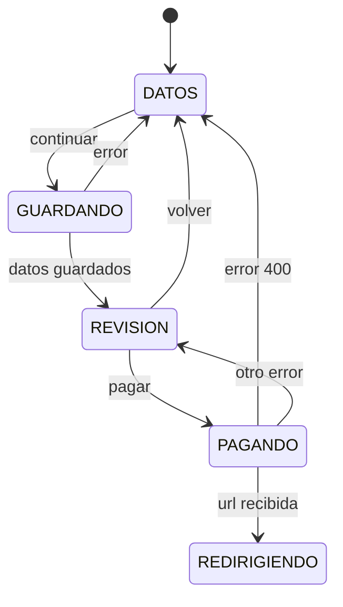

# Tienda online — checkout y pago

Datos del comprador, revisión, redirección a la pasarela (Stripe Checkout) y páginas de vuelta `/checkout/ok` y `/checkout/cancelado`. El pago lo confirma el webhook en el servidor, nunca el frontend.

API del backend (`olula_servidor`, app `tienda_online`). Todas las llamadas envían `X-Store-View`.

| Método | Ruta | Respuesta |
|---|---|---|
| PATCH | `/public/tienda_online/carrito/<token>/checkout` | body `{email, nombre, id_fiscal, telefono, direccion_facturacion, direccion_envio}`; 400 email no válido, 404, 409 |
| POST | `/public/tienda_online/carrito/<token>/pago` | `{url}`; 400 (carrito vacío, datos incompletos con la lista en el texto, stock insuficiente), 404, 409, 500 (pasarela) |
| POST | `/public/tienda_online/carrito/<token>/pago/cancelar` | `{}`; si ya estaba `ABIERTO` no hace nada |
| GET | `/public/tienda_online/carrito/<token>` | `{datos: CarritoPublico}` con `estado` y `documento {tipo, id, codigo}` |

- Dirección: `{nombre_via, tipo_via, numero, otros, cod_postal, ciudad, provincia, pais_id, telefono}`. Para pagar son obligatorios email, nombre y, de la dirección de facturación, `nombre_via`, `cod_postal`, `ciudad` y `pais_id`.
- La pasarela devuelve al comprador a `<url_base>/checkout/ok?sesion=…` o `<url_base>/checkout/cancelado`.

## Specs

### Datos

<!-- [checkout-datos-01] [x] -->
La ruta `/checkout` muestra el formulario con email, nombre, NIF (opcional), teléfono (opcional) y la dirección de facturación (vía, número, otros, código postal, ciudad, provincia y país, con `ES` por defecto). Si el carrito ya tiene `datosCheckout`, el formulario empieza con esos valores.

<!-- [checkout-datos-02] [x] -->
La casilla «Enviar a otra dirección» (desmarcada por defecto) muestra una segunda dirección con los mismos campos. Desmarcada, `direccion_envio` se envía como `null`.

<!-- [checkout-datos-03] [x] -->
Validación en el cliente (`MetaModelo` o función pura `erroresCheckout(datos)`): email con formato válido; nombre, vía, código postal, ciudad y país obligatorios; si hay dirección de envío, los mismos obligatorios en ella. Con errores no se avanza y cada campo muestra el suyo.

<!-- [checkout-datos-04] [x] -->
Sin carrito o con el carrito vacío, `/checkout` redirige a `/carrito`.

### Máquina

<!-- [checkout-maquina-01] [x] -->
[DATOS] continuar → GUARDANDO → REVISION (envía `PATCH …/checkout` con los datos en snake_case y recarga el carrito)

<!-- [checkout-maquina-02] [x] -->
[GUARDANDO] error → DATOS (muestra el texto del backend; con 404 o 409 llama a `olvidarCarrito()` y muestra «Este carrito ya no está disponible»)

<!-- [checkout-maquina-03] [cambiada] -->
En `REVISION` se muestran los datos introducidos, un bloque «Pago» con el texto «Al pulsar «Pagar» irás a la página segura de la pasarela para introducir la tarjeta. Después volverás aquí.» y los botones «Modificar datos» (vuelve a `DATOS`) y «Pagar X», con X el total formateado.
<!-- antes: las líneas y los totales iban en el mismo bloque que los datos; el botón decía solo «Pagar» -->

<!-- [checkout-maquina-04] [x] -->
[REVISION] pagar → PAGANDO → REDIRIGIENDO (envía `POST …/pago`; antes de redirigir guarda el token en `sessionStorage` bajo `tienda_online.pago_en_curso.<codigo_storeview>` y después navega a la `url` recibida con `window.location.assign`)

<!-- [checkout-maquina-05] [x] -->
[PAGANDO] error 400 → DATOS (muestra el texto del backend: datos incompletos, carrito vacío o stock insuficiente, y recarga el carrito)

<!-- [checkout-maquina-06] [x] -->
[PAGANDO] otro error → REVISION (muestra «No se ha podido iniciar el pago. Inténtalo de nuevo.»; con 404 o 409 además llama a `olvidarCarrito()`)

<!-- [checkout-maquina-07] [x] -->
En `GUARDANDO`, `PAGANDO` y `REDIRIGIENDO` los botones están deshabilitados, para no iniciar dos pagos.

### Vuelta: pago correcto

<!-- [checkout-ok-01] [x] -->
La página `/checkout/ok` toma el token de `sessionStorage` (`tienda_online.pago_en_curso.<codigo_storeview>`), porque el almacén del carrito descarta al arrancar los carritos `PAGADO` o `CONVERTIDO`. Sin token guardado muestra «No hay ningún pago en curso» con enlace al catálogo.

<!-- [checkout-ok-02] [x] -->
La página no da el pago por bueno: lee el carrito cada 2 segundos, durante 60 segundos como máximo, hasta verlo en `PAGADO`, `CONVERTIDO` o `ERROR_CONVERSION`. Una función pura `resultadoPago(estado)` devuelve `"CONFIRMADO"` (`PAGADO`, `CONVERTIDO`), `"INCIDENCIA"` (`ERROR_CONVERSION`) o `"PENDIENTE"` (el resto).

<!-- [checkout-ok-03] [x] -->
Con `CONVERTIDO` muestra «¡Gracias por tu compra!» y el número de pedido (`documento.codigo`). Con `PAGADO` muestra «Pago recibido. Estamos preparando tu pedido.»

<!-- [checkout-ok-04] [x] -->
Con `ERROR_CONVERSION` muestra «Pago recibido. Hemos tenido un problema al registrar el pedido y lo revisaremos; te contactaremos por email.»

<!-- [checkout-ok-05] [x] -->
Al llegar a `CONFIRMADO` o `INCIDENCIA` se llama a `olvidarCarrito()` y se borra el token de `sessionStorage`, de modo que el contador de la cabecera vuelve a 0.

<!-- [checkout-ok-06] [x] -->
Si pasan los 60 segundos sin confirmación, se deja de consultar y se muestra «Estamos confirmando tu pago. Si se completa, recibirás tu pedido; puedes volver a esta página más tarde.» No se olvida el carrito.

### Vuelta: pago cancelado

<!-- [checkout-cancelado-01] [x] -->
La página `/checkout/cancelado` envía `POST …/pago/cancelar` con el token guardado (el del almacén o, si no hay, el de `sessionStorage`), borra el de `sessionStorage`, recarga el carrito y muestra «Has cancelado el pago. Tu carrito sigue disponible.» con un enlace a `/carrito`.

<!-- [checkout-cancelado-02] [x] -->
Si la cancelación falla (404 o 409), muestra «Has cancelado el pago.» sin la frase del carrito ni enlace al carrito y llama a `olvidarCarrito()`.

### Diseño

<!-- [checkout-diseño-01] [nueva] -->
`/checkout` tiene dos columnas: el formulario (o la revisión) a la izquierda y, a la derecha, un resumen del pedido fijo al hacer scroll, visible en `DATOS` y en `REVISION`. En 860 px o menos, una columna con el resumen arriba. Usa el contenedor centrado de las demás páginas.

<!-- [checkout-diseño-02] [nueva] -->
El resumen tiene el título «Resumen» y una línea por artículo con la imagen pequeña (o `SinImagen`), un distintivo con la cantidad sobre la imagen, la descripción y el importe; debajo, base imponible, IVA y el total destacado.

<!-- [checkout-diseño-03] [nueva] -->
El formulario se agrupa en `fieldset` sin borde con la leyenda en la fuente de títulos: «Contacto» (email y teléfono), «Facturación» (nombre, NIF y dirección) y, si está marcada la casilla, «Dirección de envío». Los campos van en dos columnas; email, vía y la casilla ocupan el ancho completo. En 480 px o menos, una columna.

<!-- [checkout-diseño-04] [nueva] -->
Los botones del checkout son `BotonTienda`: «Continuar» y «Pagar X» `principal` a lo ancho; «Modificar datos» `secundario`.

<!-- [checkout-diseño-05] [nueva] -->
Las páginas `/checkout/ok` y `/checkout/cancelado` muestran su contenido centrado en una tarjeta, con el título en la fuente de títulos y los enlaces como `BotonTienda`.

<!-- [checkout-diseño-06] [nueva] -->
`CheckoutTienda.css`, `PagoOk.css` y `PagoCancelado.css` usan solo tokens `--tienda-*` y van en `@layer tienda.paginas`.
