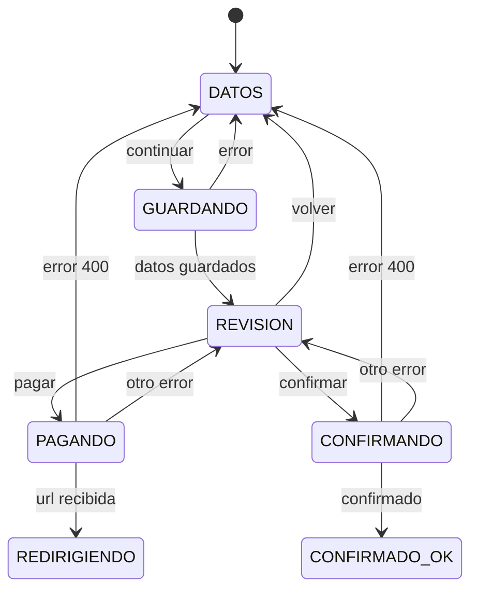

# Tienda online — checkout y pago

Datos del comprador, revisión, redirección a la pasarela (Stripe Checkout) y páginas de vuelta `/checkout/ok` y `/checkout/cancelado`. El pago lo confirma el webhook en el servidor, nunca el frontend.

API del backend (`olula_servidor`, app `tienda_online`). Todas las llamadas envían `X-Store-View`.

| Método | Ruta | Respuesta |
|---|---|---|
| PATCH | `/public/tienda_online/carrito/<token>/checkout` | body `{email, nombre, id_fiscal, telefono, direccion_facturacion, direccion_envio, id_forma_pago, id_forma_envio, dedicatoria}`; 400 email no válido o forma no válida, 404, 409 |
| POST | `/public/tienda_online/carrito/<token>/pago` | `{url}`; 400 (carrito vacío, datos incompletos con la lista en el texto, stock insuficiente), 404, 409, 500 (pasarela) |
| POST | `/public/tienda_online/carrito/<token>/confirmar` | `{}`; para formas de pago sin pasarela. Mismos 400, 404 y 409 que `…/pago` |
| POST | `/public/tienda_online/carrito/<token>/pago/cancelar` | `{}`; si ya estaba `ABIERTO` no hace nada |
| GET | `/public/tienda_online/carrito/<token>` | `{datos: CarritoPublico}` con `estado` y `documento {tipo, id, codigo}` |
| GET | `/tienda_online/cuenta/yo` (con login) | la cuenta del comprador con sus direcciones (`tienda_online/cuenta`); 401 sin sesión, 404 sin cuenta en la tienda |
| GET | `/public/tienda_online/pais` | `{datos: [{id, nombre}]}` (`cuenta-paises-01`) |

- Dirección: `{nombre_via, tipo_via, numero, otros, cod_postal, ciudad, provincia, pais_id, telefono}`. Para pagar son obligatorios email, nombre y, de la dirección de facturación, `nombre_via`, `cod_postal`, `ciudad` y `pais_id`.
- Las formas de pago y envío disponibles vienen en el StoreView (`formas_pago` y `formas_envio`: id, código, nombre, descripción y tipo). Tipos de pago: `PASARELA` y `SIN_PASARELA`. Tipos de envío: `DOMICILIO` y `RECOGIDA`.
- El carrito trae `forma_pago` y `forma_envio` (id, nombre y tipo) o nulo, y un estado nuevo, `CONFIRMADO`.
- El carrito trae también `formas_pago_disponibles` y `formas_envio_disponibles` (mismos campos que las del StoreView): las que admite ese carrito, que una extensión puede haber filtrado.
- La pasarela devuelve al comprador a `<url_base>/checkout/ok?sesion=…` o `<url_base>/checkout/cancelado`.

## Specs

### Datos

<!-- [checkout-datos-01] [x] -->
La ruta `/checkout` muestra el formulario con email, nombre, NIF (opcional), teléfono (opcional) y la dirección de facturación (vía, número, otros, código postal, ciudad, provincia y país, con `ES` por defecto). Si el carrito ya tiene `datosCheckout`, el formulario empieza con esos valores.

<!-- [checkout-datos-02] [x] -->
La casilla «Enviar a otra dirección» (desmarcada por defecto) muestra una segunda dirección con los mismos campos. Desmarcada, `direccion_envio` se envía como `null`.

<!-- [checkout-datos-03] [x] -->
Validación en el cliente (`MetaModelo` o función pura `erroresCheckout(datos)`): email con formato válido; nombre, vía, código postal, ciudad y país obligatorios; si hay dirección de envío, los mismos obligatorios en ella. Con errores no se avanza y cada campo muestra el suyo.

<!-- [checkout-datos-04] [x] -->
Sin carrito o con el carrito vacío, `/checkout` redirige a `/carrito`.

<!-- [checkout-datos-05] [nueva] -->
Un `fieldset` «Envío» lista las formas de envío disponibles del carrito (`formas_envio_disponibles`) como opciones de radio, con el nombre y, debajo, la descripción. Empieza marcada la del carrito o, si no tiene, la primera.

<!-- [checkout-datos-06] [nueva] -->
Con una forma de envío de tipo `RECOGIDA` se ocultan la casilla «Enviar a otra dirección» y la dirección de envío, y `direccion_envio` se envía como `null`.

<!-- [checkout-datos-07] [nueva] -->
Un `fieldset` «Pago» lista las formas de pago disponibles del carrito (`formas_pago_disponibles`) igual que el de envío. Empieza marcada la del carrito o, si no tiene, la primera.

<!-- [checkout-datos-08] [nueva] -->
`PATCH …/checkout` envía también `id_forma_pago` e `id_forma_envio`.

<!-- [checkout-datos-09] [nueva] -->
Si el carrito solo tiene disponible una forma de envío o una de pago, su `fieldset` muestra esa forma como texto, sin radio.

<!-- [checkout-datos-10] [x] -->
Con `FactoryTiendaOnline.checkout_dedicatoria` a `true` (en la base es `false`; Dulce Bebé lo activa), el formulario muestra un `fieldset` «Dedicatoria» con un área de texto opcional, que empieza con la `dedicatoria` del carrito. `PATCH …/checkout` la envía como `dedicatoria` (vacía, `null`). Con el ajuste a `false` no se muestra ni se envía.

<!-- [checkout-datos-11] [nueva] -->
En la revisión, si hay dedicatoria, el resumen de datos la muestra bajo «Dedicatoria».

### Comprador con cuenta

<!-- [checkout-cuenta-01] [x] -->
Al cargar, el checkout pide la cuenta (`getCuenta` de `tienda_online/cuenta`). Si responde, el comprador tiene cuenta y el contexto guarda la cuenta. Si falla (sin sesión, 404 u otro error), el checkout es el de invitado de siempre. Mientras carga no se muestra el formulario.

<!-- [checkout-cuenta-02] [x] -->
Con cuenta, «Contacto» muestra el email como texto, no editable, y el teléfono; «Facturación» trae nombre y NIF. Si el carrito no trae nombre ni vía de facturación (aunque tenga `datosCheckout`, por ejemplo solo con la forma de envío), email, nombre, NIF, teléfono y dirección de facturación empiezan con los de la cuenta.

<!-- [checkout-cuenta-03] [x] -->
Con cuenta, la dirección de facturación se elige entre las direcciones de la cuenta, como tarjetas de radio con `textoDireccion` (las mismas que las formas de envío y pago, `checkout-diseño-07`). Empieza marcada la de facturación de la cuenta. Debajo, «Usar otra dirección» muestra el formulario de dirección vacío y se convierte en «Elegir una de mis direcciones», que lo oculta y vuelve a la tarjeta marcada. La dirección elegida se copia en `direccion_facturacion`; la otra dirección se usa solo en este pedido y no se guarda en la cuenta. Si la cuenta no tiene direcciones, se muestra directamente el formulario.

<!-- [checkout-cuenta-04] [x] -->
Con cuenta y una forma de envío `DOMICILIO`, la casilla «Enviar a otra dirección» muestra el mismo selector para la dirección de envío, con la de envío de la cuenta marcada y su propio «Usar otra dirección».

<!-- [checkout-cuenta-05] [x] -->
Las funciones que pasan una dirección de la cuenta a `DireccionCheckout` y que eligen la dirección inicial (facturación o envío) son puras y están en `checkout/dominio.ts`.

### Máquina

<!-- [checkout-maquina-01] [x] -->
[DATOS] continuar → GUARDANDO → REVISION (envía `PATCH …/checkout` con los datos en snake_case y recarga el carrito)

<!-- [checkout-maquina-02] [x] -->
[GUARDANDO] error → DATOS (muestra el texto del backend; con 404 o 409 llama a `olvidarCarrito()` y muestra «Este carrito ya no está disponible»)

<!-- [checkout-maquina-03] [cambiada] -->
En `REVISION` se muestran los datos introducidos, la forma de envío, un bloque «Pago» y los botones «Modificar datos» (vuelve a `DATOS`) y el de terminar. Con una forma de pago `PASARELA`, el bloque dice «Al pulsar «Pagar» irás a la página segura de la pasarela para introducir la tarjeta. Después volverás aquí.» y el botón es «Pagar X», con X el total formateado. Con `SIN_PASARELA`, el bloque muestra el nombre y la descripción de la forma de pago y el botón es «Confirmar pedido».
<!-- antes: siempre pasarela y «Pagar X» -->

<!-- [checkout-maquina-04] [x] -->
[REVISION] pagar → PAGANDO → REDIRIGIENDO (envía `POST …/pago`; antes de redirigir guarda el token en `sessionStorage` bajo `tienda_online.pago_en_curso.<codigo_storeview>` y después navega a la `url` recibida con `window.location.assign`)

<!-- [checkout-maquina-05] [x] -->
[PAGANDO] error 400 → DATOS (muestra el texto del backend: datos incompletos, carrito vacío o stock insuficiente, y recarga el carrito)

<!-- [checkout-maquina-06] [x] -->
[PAGANDO] otro error → REVISION (muestra «No se ha podido iniciar el pago. Inténtalo de nuevo.»; con 404 o 409 además llama a `olvidarCarrito()`)

<!-- [checkout-maquina-08] [nueva] -->
[REVISION] confirmar → CONFIRMANDO → CONFIRMADO_OK (envía `POST …/confirmar`; después guarda el token en `sessionStorage` igual que al pagar y navega a `/checkout/ok`)

<!-- [checkout-maquina-09] [nueva] -->
[CONFIRMANDO] error 400 → DATOS y otro error → REVISION, con los mismos textos y el mismo tratamiento de 404 y 409 que `PAGANDO`; el texto genérico es «No se ha podido confirmar el pedido. Inténtalo de nuevo.»

<!-- [checkout-maquina-07] [cambiada] -->
En `GUARDANDO`, `PAGANDO`, `REDIRIGIENDO`, `CONFIRMANDO` y `CONFIRMADO_OK` los botones están deshabilitados, para no iniciar dos pagos.
<!-- antes: no existían CONFIRMANDO ni CONFIRMADO_OK -->

### Vuelta: pago correcto

<!-- [checkout-ok-01] [x] -->
La página `/checkout/ok` toma el token de `sessionStorage` (`tienda_online.pago_en_curso.<codigo_storeview>`), porque el almacén del carrito descarta al arrancar los carritos `PAGADO` o `CONVERTIDO`. Sin token guardado muestra «No hay ningún pago en curso» con enlace al catálogo.

<!-- [checkout-ok-02] [cambiada] -->
La página no da el pago por bueno: lee el carrito cada 2 segundos, durante 60 segundos como máximo, hasta verlo en `PAGADO`, `CONFIRMADO`, `CONVERTIDO` o `ERROR_CONVERSION`. Una función pura `resultadoPago(estado)` devuelve `"CONFIRMADO"` (`PAGADO`, `CONFIRMADO`, `CONVERTIDO`), `"INCIDENCIA"` (`ERROR_CONVERSION`) o `"PENDIENTE"` (el resto).
<!-- antes: no existía el estado CONFIRMADO del carrito -->

<!-- [checkout-ok-03] [x] -->
Con `CONVERTIDO` muestra «¡Gracias por tu compra!» y el número de pedido (`documento.codigo`). Con `PAGADO` muestra «Pago recibido. Estamos preparando tu pedido.»

<!-- [checkout-ok-07] [nueva] -->
Si la forma de pago del carrito es `SIN_PASARELA`, los textos hablan de pedido y no de pago: con `CONVERTIDO`, «¡Gracias por tu pedido!» y el número de pedido; con `CONFIRMADO`, «Pedido recibido. Lo estamos preparando.»; con `ERROR_CONVERSION`, «Hemos recibido tu pedido, pero hemos tenido un problema al registrarlo. Lo revisaremos y te contactaremos por email.» Debajo se muestra la descripción de la forma de pago.

<!-- [checkout-ok-04] [x] -->
Con `ERROR_CONVERSION` muestra «Pago recibido. Hemos tenido un problema al registrar el pedido y lo revisaremos; te contactaremos por email.»

<!-- [checkout-ok-05] [x] -->
Al llegar a `CONFIRMADO` o `INCIDENCIA` se llama a `olvidarCarrito()` y se borra el token de `sessionStorage`, de modo que el contador de la cabecera vuelve a 0.

<!-- [checkout-ok-06] [x] -->
Si pasan los 60 segundos sin confirmación, se deja de consultar y se muestra «Estamos confirmando tu pago. Si se completa, recibirás tu pedido; puedes volver a esta página más tarde.» No se olvida el carrito.

<!-- [checkout-ok-08] [nueva] -->
El botón de `/checkout/ok` usa el origen del carrito pagado (`useSeguirComprando` con el token del pago en curso). Si el carrito venía de una lista, muestra «Volver a la lista» y lleva a la lista; si no, sigue siendo «Seguir comprando» con la ruta de la tienda.

### Vuelta: pago cancelado

<!-- [checkout-cancelado-01] [x] -->
La página `/checkout/cancelado` envía `POST …/pago/cancelar` con el token guardado (el del almacén o, si no hay, el de `sessionStorage`), borra el de `sessionStorage`, recarga el carrito y muestra «Has cancelado el pago. Tu carrito sigue disponible.» con un enlace a `/carrito`.

<!-- [checkout-cancelado-02] [x] -->
Si la cancelación falla (404 o 409), muestra «Has cancelado el pago.» sin la frase del carrito ni enlace al carrito y llama a `olvidarCarrito()`.

### Editar el carrito

<!-- [checkout-carrito-01] [x] -->
En `DATOS`, cada línea del resumen tiene bajo la descripción el selector de cantidad (`CambiarCantidadLinea`, con «−» y «+») y «Quitar» (`BorrarLineaCarrito`), los mismos de la página del carrito y del cajón. Usan su máquina de edición (`useEdicionCarrito`), así que se comportan igual: el cambio se envía al momento, el carrito se recarga y los errores 400, 404 y 409 se tratan como en `carrito-lineas-03` a `-07`. El resumen y el total se actualizan solos con el carrito recargado. En `REVISION` y después, el resumen es solo de lectura; para cambiar el carrito hay que pulsar «Modificar datos».

<!-- [checkout-carrito-02] [x] -->
Mientras una edición está en curso, los controles de las líneas y «Revisar pedido» están deshabilitados. El error de la edición se muestra dentro de la tarjeta del resumen, encima de las líneas.

<!-- [checkout-carrito-03] [x] -->
Si al quitar la última línea el carrito queda vacío, el checkout navega a `/carrito`, que muestra «Tu carrito está vacío».

<!-- [checkout-carrito-04] [x] -->
Si tras recargar el carrito la forma de envío o de pago marcada ya no está entre las disponibles (por ejemplo, al quitar las líneas de una lista de regalos), se marca la primera disponible, con la regla de recogida de `checkout-datos-06`. La función que lo decide es pura y está en `checkout/dominio.ts`.

<!-- [checkout-carrito-05] [x] -->
Debajo de las líneas del resumen, en `DATOS`, hay un enlace «Seguir comprando» (`useSeguirComprando`) para añadir otros artículos. El carrito conserva sus líneas; los datos del formulario solo se conservan si ya se habían guardado con «Revisar pedido».

### Diseño

<!-- [checkout-diseño-01] [x] -->
`/checkout` tiene dos columnas: el formulario (o la revisión) a la izquierda y, a la derecha, un resumen del pedido fijo al hacer scroll, visible en `DATOS` y en `REVISION`. En 860 px o menos, una columna con el resumen arriba. Usa el contenedor centrado de las demás páginas.

<!-- [checkout-diseño-02] [x] -->
El resumen tiene el título «Resumen» y una línea por artículo con la imagen de 72 px (o `SinImagen`), un distintivo con la cantidad sobre la imagen, la descripción y el importe. Debajo, solo el total destacado y, bajo él en texto pequeño y color secundario, «IVA incluido (X)» con el importe del IVA. Desaparecen las líneas de base imponible e IVA.

<!-- [checkout-diseño-03] [x] -->
El formulario se agrupa en `fieldset` sin borde con la leyenda en la fuente de títulos: «Contacto» (email y teléfono), «Facturación» (nombre, NIF y dirección) y, si está marcada la casilla, «Dirección de envío». Los campos van en dos columnas; email, vía y la casilla ocupan el ancho completo. En 480 px o menos, una columna.

<!-- [checkout-diseño-04] [x] -->
Los botones del checkout son `BotonTienda`: «Continuar» y «Pagar X» `principal` a lo ancho; «Modificar datos» `secundario`.

<!-- [checkout-diseño-05] [x] -->
Las páginas `/checkout/ok` y `/checkout/cancelado` muestran su contenido centrado en una tarjeta, con el título en la fuente de títulos y los enlaces como `BotonTienda`.

<!-- [checkout-diseño-07] [nueva] -->
Las opciones de envío y de pago son tarjetas a lo ancho con el radio a la izquierda, el nombre en negrita y la descripción debajo en color secundario; la marcada lleva el borde del color principal de la tienda.

<!-- [checkout-diseño-08] [x] -->
Cada `fieldset` del formulario («Contacto», «Facturación», «Dirección de envío», «Envío» y «Pago») es una tarjeta como la del resumen: fondo `superficie`, borde, `--tienda-radio-tarjeta` y relleno `--tienda-espacio-6`. La leyenda va dentro de la tarjeta, numerada («1. Contacto», «2. Facturación»…). Entre tarjetas hay `--tienda-espacio-4`.

<!-- [checkout-diseño-09] [x] -->
El formulario de dirección se ordena en filas: tipo de vía (un tercio) y vía (dos tercios); número y otros; código postal y ciudad; provincia y país. El campo «Teléfono de contacto» de la dirección desaparece: la dirección se envía con el teléfono de «Contacto». En 480 px o menos, una columna.

<!-- [checkout-diseño-10] [x] -->
El país es un `AutocompletarTienda` (`tienda-primitivos-10`) con los países de `GET /public/tienda_online/pais`, cargados al abrir el checkout; si fallan, solo ofrece `ES`. En el checkout los obligatorios no llevan asterisco ni aparece «Los campos con * son obligatorios»: solo los opcionales llevan «(opcional)» en la etiqueta (Teléfono, NIF, Tipo de vía, Número, Otros y Provincia). Los errores de obligatorio siguen saliendo al continuar.

<!-- [checkout-diseño-11] [x] -->
En `DATOS`, el botón «Revisar pedido» va dentro de la tarjeta del resumen, debajo del total, a lo ancho y fijo con él al hacer scroll. En `REVISION`, el de terminar («Pagar X» o «Confirmar pedido») va en el mismo sitio; «Modificar datos» sigue en la columna izquierda. En 860 px o menos, con el resumen arriba, los botones van al final de la columna del formulario. El botón envía el formulario (`form` asociado por id), así que Intro en un campo también continúa.

<!-- [checkout-diseño-12] [x] -->
Las tarjetas de dirección de la cuenta (`checkout-cuenta-03`) llevan el radio a la izquierda, separado, y a la derecha el texto en líneas: vía y número en negrita; código postal y ciudad; provincia y nombre del país (de la lista de países, o el código si no está). La función que da esas líneas es pura y está en `checkout/dominio.ts`.

<!-- [checkout-diseño-13] [x] -->
Cada leyenda de tarjeta lleva un icono `QIcono` de tamaño `sm` delante del número: «Contacto» `usuario`, «Facturación» `menu_fiscalidad`, «Dirección de envío» `casa`, «Envío» `menu_compras` y «Pago» `tarjeta`.

<!-- [checkout-diseño-14] [x] -->
Bajo el título «Datos del pedido» (y «Revisa tu pedido» en `REVISION`) hay una barra de pasos: «1 Datos», «2 Revisión» y «3 Pago», unidos por una línea. En `DATOS` está activo el 1; en `REVISION`, el 1 aparece completado y activo el 2; el 3 se activa al pagar o confirmar. El paso activo va en el color principal de la tienda y en negrita; los completados, con `IconCheck`.

<!-- [checkout-diseño-15] [x] -->
En la tarjeta «Envío», una forma `RECOGIDA` muestra «Sin coste» junto al nombre. La descripción de la forma (dónde y en qué horario se recoge) sale debajo, como ya hace `checkout-diseño-07`; su texto se edita en la forma de envío de la tienda.

<!-- [checkout-diseño-06] [x] -->
`CheckoutTienda.css`, `PagoOk.css` y `PagoCancelado.css` usan solo tokens `--tienda-*` y van en `@layer tienda.paginas`.
